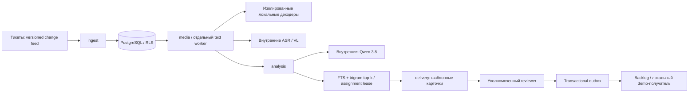

# Архитектура MVP

Агент анализирует обращения поддержки, выделяет повторяющиеся потребности и передаёт подтверждённые карточки продуктовым командам. Доступ, версии, частоты и доставка контролируются кодом.

## Границы и поток

Одна кодовая база, четыре границы сервисов: ingest, media, analysis, delivery. API, scheduler, sender и зарезервированный media_text worker запускаются отдельными командами. Scheduler не встроен в API-workers. PostgreSQL — и база, и очередь, и координатор capacity. Redis, Kafka, векторная БД и агентный фреймворк не используются.

* **ingest:** страницы упорядоченных изменений, immutable snapshots по версии, принятие собственной монотонной ревизии. Курсор, ревизии и jobs коммитятся вместе. Повторенная/запоздалая последовательность игнорируется. Одна source version под новым sequence не создаёт новую accepted revision; изменение её содержимого отвергается. Gateway получает стабильный initial_since. Начальный охват — 30 дней; явно помеченный backfill идёт с меньшим приоритетом.
* **media:** текст и комментарии (единый source text), DOCX, текстовые/смешанные PDF по страницам, PNG/JPEG, PCM WAV. Готовая usable-расшифровка переиспользуется. Остальные форматы дают видимый partial. Нет переходов по ссылкам или выполнения кода документов. На Linux декодеры ограничены 768 MiB адресного пространства и 8 сек CPU; wall timeout 12 сек. На macOS есть CPU/wall лимиты, но RLIMIT_AS не применяется: production-эквивалент памяти проверяется в Linux-контейнере. Парсер возвращает ограниченный текст. Media обрабатываются последовательно внутри job; успешные файлы сохраняются в product/revision-scoped cache.
* **analysis:** сегменты разбиваются на ограниченные контексты. Pydantic strict + запрет extra fields; цитаты проверяются как точные подстроки канонических маскированных сегментов. Validated extraction сохраняется до assignment и переиспользуется при Capacity/retry. Одна попытка исправления JSON; общий счётчик всех вызовов провайдеров сохраняется в ревизии, включая неуспешные обращения. FTS/trigram с конфигурируемыми синонимами выбирает до 20 кандидатов, до 5 передаёт matching. Неуверенные группы видимы как provisional; они не попадают в автоматическую подборку.
* **delivery:** минимум 2 origin за 30 дней; пожелания и дефекты раздельны. Числа вычисляются кодом. До 5 разных новых/изменившихся карточек за бизнес-день; повтор неизменного snapshot не меняет revision/hash. Следующий бизнес-день учитывает оставшиеся группы; повторный проход того же дня сохраняет общий предел пяти разных карточек. В reviewed разрешение и outbox создаются одной транзакцией. В shadow внешних записей нет даже после accepted.

## Инварианты данных

Предметные таблицы содержат product_id. Составные FK включают product_id; связь с чужой группой/ревизией запрещает БД. Products используют id как scope; principals — серверный реестр аутентификации; provider_slots — общая инфраструктура. Учитываются source_id, external_id, внешняя opaque version, собственная accepted revision, хеш, версии нормализации/маскирования/промпта/схемы, model_id, время и coverage. Все DateTime — timestamptz/UTC. Календарь подборок — Europe/Moscow и подменяемые часы.

Needs связывают ревизию с группой; Membership имеет unique(product_id, group_id, origin_id). Состав origin пересчитывается из актуальных eligible needs, а не инкрементируется. Два одинаковых независимых текста — два origin. Явный duplicate_of наследует origin доверенной корневой записи. Источник обязан передавать корни до дублей и сохранять ациклическую связь. Изменение связи пересчитывает origin потомков; цикл отклоняется без частичного коммита.

Observation хранит первый timestamp по хешу потребности тикета, GroupObservation — по семантической группе; перефразирование внутри той же группы не омолаживает потребность. Повтор не омолаживает потребность. occurred_at в контракте — время исходного запроса в соответствующей версии; источник обязан сохранить его при техническом переэкспорте. Для неизвестного времени интегратор использует первое наблюдение и помечает backfill/fallback. Автоматически выделить timestamp каждого фрагмента смешанного исторического тикета невозможно; он берётся из версии как общее документированное приближение.

## Координация и сбои

Jobs: queued → running → succeeded; временный сбой → retry_wait; не более 3 попыток → dead; замена/удаление → cancelled. Claim использует `FOR UPDATE SKIP LOCKED`, lease и случайный fencing token; истёкший token не может продлить/завершить новый claim. Полезная работа и HTTP идут вне транзакций. Завершение stage и enqueue следующего атомарны.

Assignment сериализуется только внутри продукта через lease с fencing; model I/O не удерживает соединение. Другой продукт может группироваться одновременно. Heartbeat продлевает job, assignment и provider slot. Новая source version инвалидирует выполняющееся assignment. Внешние вызовы имеют timeout; capacity исчерпана → ограниченное ожидание в очереди без model HTTP и без расходования попытки.

Provider slots общие для всех процессов: по 2 на LLM/ASR/VL после bootstrap. `MODEL_SLOTS` определяет инициализацию, не горячее изменение уже созданной capacity. Изменять число слотов нужно в остановленном контуре с проверкой отсутствия активных leases. Text jobs имеют отдельный kind/приоритет; выделенный media_text worker не занимается большими файлами. Prefetch = 1, DB pool = 4+2 соединения на процесс; итоговое число процессов должно соответствовать лимиту PostgreSQL.

## Доступ и недоверенный контент

Bearer tokens генерируются случайно только в local/demo, в БД сохраняются хеши. Роли и продукты определяются серверными grants. Operator не получает reviewer. Internal JWT: RS256, подпись, issuer, audience, exp/iat/sub. Роли из body/заголовков/текста источника не принимаются. API-роль отделена от worker и не может изменять извлечённые факты. Обе runtime-роли — non-owner, NOSUPERUSER, NOBYPASSRLS. FORCE RLS применяется ко всем product-scoped таблицам, scope задаётся transaction-local, пустой scope запрещает строки. Worker — доверенный сервисный principal с настроенным набором продуктов; отдельные DB-роли для каждого из четырёх stage в MVP не заведены.

LLM не получает write-tools и credentials. Workflow сам выполняет retrieval и write-операции, проверяет candidate IDs и evidence. Regex-маскирование скрывает очевидные email, российские телефоны и обозначенные секреты, сохраняет смысл чисел; это не полная DLP/анонимизация. Заменители устойчивы в пределах product и версии политики. Исходные данные остаются в ограниченной БД до удаления/retention, обычное чтение использует маскированные сегменты.

## Ссылки разработчика

Механизм очереди опирается на [SELECT / SKIP LOCKED](https://www.postgresql.org/docs/17/sql-select.html), дополнительная изоляция — на [PostgreSQL Row Security](https://www.postgresql.org/docs/17/ddl-rowsecurity.html). Эти страницы не загружаются runtime-агентом.

## Эксплуатационный контур 0.2

Старые миграции содержат зафиксированный DDL, не живую metadata текущих моделей. Миграция0004 добавляет review/extraction/observations и ограничения. Readiness сверяет текущую схему с migration head установленного пакета.

Административный `provision` создаёт registry из строгого JSON: продукты/owners, verified issuer subjects, роли, cursors/leases, shared provider slots и небольшой trusted catalog известных задач. Курсоры не сбрасываются. Меняются bindings только заявленных actors в заявленных продуктах; другие scope сохраняются. Изменение owner/catalog инвалидирует snapshots под product lease. Demo seed — отдельная local-only операция.

Retention использует дату каждой ревизии, обрабатывает metadata ограниченными batches и очищает все копии по ticket/revision provenance, включая исторические карточки и receipts. Обновление тикета не продлевает TTL его старых raw/segments. Свежая текущая ревизия переживает очистку старой истории.

API содержит review-очередь, outbox и явное разрешение unknown/correction. Ответы/request bodies ограничены; evidence пагинируется и относится только к текущей разрешённой ревизии. Операторский resend требует нового reviewer action. Метрики считаются SQL-агрегатами, без загрузки raw content в API-процесс.

Runtime Docker устанавливает обычный wheel с ресурсами. `migrate` и `bootstrap` получают отдельную административную конфигурацию; API/workers её не наследуют. Проверки запускаются единообразно через Makefile и CI. [Воспроизведение](quickstart.md), [рабочие сценарии](workflows.md).
